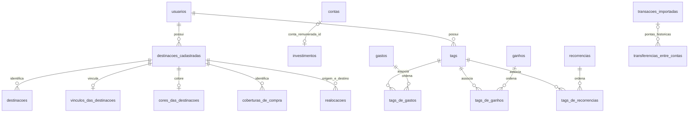

# Banco do Gastoba — modelo normalizado local

Data: 2026-11-08. Gerado do metadata SQLAlchemy de `backend/src/gastoba/infrastructure/persistencia/modelos.py`.

**SGBD: SQLite**, URL padrão `sqlite:///./gastobs.db`. SQLAlchemy 2 faz a persistência e Alembic versiona o esquema. Dinheiro é armazenado em centavos inteiros.

O modelo local da entrega conjunta 054/055 contém **28 tabelas de negócio e uma view** (`pontas_de_transferencias`), além da tabela técnica `alembic_version`. A main local f778c6e possui 20 tabelas de negócio. O desenho inclui mudanças ainda sem commit; **não é inspeção de produção**.

## Visão das correções 055

`pontas_de_transferencias` agora é uma **view somente leitura** das duas pontas das transferências ativas. Índices UNIQUE parciais asseguram exclusividade ativa; triggers validam conta, dono, valor e sentido. Uma transação de saída só pode ocupar a origem; uma entrada, o destino. Reversão desativa a transferência, libera a exclusividade e mantém as referências históricas.

## Diagrama físico completo

PK = chave primária; FK = chave estrangeira; UK = unicidade simples. Chaves compostas e CHECKs constam no catálogo. Os nomes expostos por `column_property` e listas da API são projeções e não colunas repetidas.

```mermaid
erDiagram
    usuarios {
        char id PK
        varchar nome
        varchar email UK
        varchar senha_hash
    }
    chaves_de_api {
        char id PK
        char usuario_id FK
        varchar nome
        varchar prefixo
        varchar hash_do_segredo UK
        varchar escopo
        datetime criada_em
        datetime ultimo_uso
        datetime expira_em
        boolean revogada
    }
    contas {
        char id PK
        char usuario_id FK
        varchar nome
        bigint saldo_centavos
        varchar origem
        varchar id_externo
        varchar papel
        varchar tipo
    }
    destinacoes_cadastradas {
        char id PK
        char usuario_id FK
        varchar nome
    }
    metas {
        char id PK
        char usuario_id FK
        varchar categoria
        integer percentual
    }
    rendas_base {
        char usuario_id PK,FK
        bigint valor_centavos
    }
    sessoes {
        char id PK
        char usuario_id FK
        varchar hash_do_segredo UK
        datetime criada_em
        datetime expira_em
        boolean revogada
    }
    tags {
        char id PK
        char usuario_id FK
        varchar nome
    }
    cores_das_destinacoes {
        char id PK
        char destinacao_id FK
        varchar cor
    }
    faturas {
        char id PK
        char conta_id FK
        varchar id_externo
        date inicio
        date fechamento
        date vencimento
        bigint total_centavos
        bigint minimo_centavos
        varchar fonte
    }
    investimentos {
        char id PK
        char usuario_id FK
        char conta_remunerada_id FK,UK
        varchar id_externo
        varchar nome
        varchar tipo
        varchar subtipo
        bigint saldo_centavos
        bigint valor_aplicado_centavos
        bigint rendimento_centavos
        text dados
    }
    recorrencias {
        char id PK
        varchar tipo
        char conta_id FK
        bigint valor_centavos
        varchar descricao
        integer dia_do_mes
        date inicio
        date fim
        varchar categoria
        boolean ativa
    }
    vinculos_das_destinacoes {
        char id PK
        char destinacao_id FK
        varchar categoria
    }
    investimentos_historico {
        char id PK
        char investimento_id FK
        date data
        bigint saldo_centavos
    }
    pagamentos_de_fatura {
        char id PK
        char fatura_id FK
        date data
        bigint valor_centavos
        varchar forma
    }
    realocacoes {
        char id PK
        char investimento_id FK
        date data
        char destinacao_origem_id FK
        char destinacao_destino_id FK
        bigint valor_centavos
    }
    referencias_mensais_de_caixinhas {
        char investimento_id PK,FK
        varchar mes PK
        bigint saldo_inicial_centavos
        bigint saldo_final_centavos
        boolean periodo_completo
    }
    tags_de_recorrencias {
        char recorrencia_id PK,FK
        char tag_id PK,FK
        integer ordem
    }
    transacoes_importadas {
        char id PK
        char conta_id FK
        varchar id_externo
        date data
        varchar descricao
        bigint valor_centavos
        varchar sentido
        varchar tipo_de_operacao
        varchar estado
        char fatura_id FK
        varchar id_externo_da_fatura
        integer parcela_numero
        integer parcela_total
    }
    ganhos {
        char id PK
        char conta_id FK
        varchar descricao
        bigint valor_centavos
        date data
        varchar origem
        char recorrencia_id FK
        varchar competencia
        char transacao_importada_id FK
    }
    gastos {
        char id PK
        char conta_id FK
        varchar descricao
        bigint valor_centavos
        date data
        varchar categoria
        varchar origem
        char recorrencia_id FK
        varchar competencia
        char transacao_importada_id FK
    }
    movimentos_de_investimento {
        char id PK
        char conta_id FK
        char investimento_id FK
        char movimento_relacionado_id FK
        varchar categoria
        boolean revisao_contabil_pendente
        boolean revisao_pendente
        varchar tipo
        varchar descricao
        bigint valor_centavos
        date data
        varchar origem
        char transacao_importada_id FK
    }
    reversoes_de_classificacao {
        char id PK
        char usuario_id FK
        char transacao_id FK
        varchar estado_anterior
        datetime instante
        json lancamentos
    }
    transferencias_entre_contas {
        char id PK
        char usuario_id FK
        char conta_origem_id FK
        char conta_destino_id FK
        bigint valor_centavos
        date data
        varchar papel_origem
        varchar papel_destino
        char transacao_origem_id FK
        char transacao_destino_id FK
        boolean competencia_provisoria
        boolean ativa
    }
    coberturas_de_compra {
        char id PK
        char gasto_id FK
        char destinacao_id FK
        bigint valor_centavos
        char movimento_id FK
        bigint principal_centavos
    }
    destinacoes {
        char id PK
        char movimento_id FK
        char destinacao_id FK
        bigint valor_centavos
        bigint principal_centavos
        varchar categoria
    }
    tags_de_ganhos {
        char ganho_id PK,FK
        char tag_id PK,FK
        integer ordem
    }
    tags_de_gastos {
        char gasto_id PK,FK
        char tag_id PK,FK
        integer ordem
    }
    usuarios ||--o{ chaves_de_api : "usuario_id"
    usuarios ||--o{ contas : "usuario_id"
    usuarios ||--o{ destinacoes_cadastradas : "usuario_id"
    usuarios ||--o{ metas : "usuario_id"
    usuarios ||--o| rendas_base : "usuario_id"
    usuarios ||--o{ sessoes : "usuario_id"
    usuarios ||--o{ tags : "usuario_id"
    destinacoes_cadastradas ||--o| cores_das_destinacoes : "destinacao_id"
    contas ||--o{ faturas : "conta_id"
    usuarios ||--o{ investimentos : "usuario_id"
    contas |o--o| investimentos : "conta_remunerada_id"
    contas ||--o{ recorrencias : "conta_id"
    destinacoes_cadastradas ||--o| vinculos_das_destinacoes : "destinacao_id"
    investimentos ||--o{ investimentos_historico : "investimento_id"
    faturas ||--o{ pagamentos_de_fatura : "fatura_id"
    investimentos ||--o{ realocacoes : "investimento_id"
    destinacoes_cadastradas ||--o{ realocacoes : "destinacao_origem_id"
    destinacoes_cadastradas ||--o{ realocacoes : "destinacao_destino_id"
    investimentos ||--o{ referencias_mensais_de_caixinhas : "investimento_id"
    recorrencias ||--o{ tags_de_recorrencias : "recorrencia_id"
    tags ||--o{ tags_de_recorrencias : "tag_id"
    contas ||--o{ transacoes_importadas : "conta_id"
    faturas |o--o{ transacoes_importadas : "fatura_id"
    contas ||--o{ ganhos : "conta_id"
    recorrencias |o--o{ ganhos : "recorrencia_id"
    transacoes_importadas |o--o{ ganhos : "transacao_importada_id"
    contas ||--o{ gastos : "conta_id"
    recorrencias |o--o{ gastos : "recorrencia_id"
    transacoes_importadas |o--o{ gastos : "transacao_importada_id"
    contas |o--o{ movimentos_de_investimento : "conta_id"
    investimentos |o--o{ movimentos_de_investimento : "investimento_id"
    movimentos_de_investimento |o--o{ movimentos_de_investimento : "movimento_relacionado_id"
    transacoes_importadas |o--o{ movimentos_de_investimento : "transacao_importada_id"
    usuarios ||--o{ reversoes_de_classificacao : "usuario_id"
    transacoes_importadas ||--o{ reversoes_de_classificacao : "transacao_id"
    usuarios ||--o{ transferencias_entre_contas : "usuario_id"
    contas ||--o{ transferencias_entre_contas : "conta_origem_id"
    contas ||--o{ transferencias_entre_contas : "conta_destino_id"
    transacoes_importadas |o--o{ transferencias_entre_contas : "transacao_origem_id"
    transacoes_importadas |o--o{ transferencias_entre_contas : "transacao_destino_id"
    gastos ||--o{ coberturas_de_compra : "gasto_id"
    destinacoes_cadastradas ||--o{ coberturas_de_compra : "destinacao_id"
    movimentos_de_investimento |o--o{ coberturas_de_compra : "movimento_id"
    movimentos_de_investimento ||--o{ destinacoes : "movimento_id"
    destinacoes_cadastradas ||--o{ destinacoes : "destinacao_id"
    ganhos ||--o{ tags_de_ganhos : "ganho_id"
    tags ||--o{ tags_de_ganhos : "tag_id"
    gastos ||--o{ tags_de_gastos : "gasto_id"
    tags ||--o{ tags_de_gastos : "tag_id"
```

## Catálogo de campos e restrições

### usuarios

| Campo | Tipo | Chaves / referência |
|---|---|---|
| `id` | `CHAR(32)` | PK |
| `nome` | `VARCHAR(100)` |  |
| `email` | `VARCHAR(254)` | opcional |
| `senha_hash` | `VARCHAR(255)` | opcional |

- UNIQUE: `email`.

### chaves_de_api

| Campo | Tipo | Chaves / referência |
|---|---|---|
| `id` | `CHAR(32)` | PK |
| `usuario_id` | `CHAR(32)` | FK → `usuarios.id` |
| `nome` | `VARCHAR(60)` |  |
| `prefixo` | `VARCHAR(8)` |  |
| `hash_do_segredo` | `VARCHAR(64)` |  |
| `escopo` | `VARCHAR(20)` |  |
| `criada_em` | `DATETIME` |  |
| `ultimo_uso` | `DATETIME` | opcional |
| `expira_em` | `DATETIME` | opcional |
| `revogada` | `BOOLEAN` |  |

- CHECK `ck_chaves_de_api_escopo_valido`: `escopo IN ('leitura', 'escrita')`.
- CHECK `ck_chaves_de_api_nome_valido`: `length(trim(nome)) >= 1 AND length(nome) <= 60`.
- Índice `ix_chaves_de_api_hash_do_segredo` UNIQUE: `hash_do_segredo`.
- Índice `ix_chaves_de_api_usuario_id`: `usuario_id`.

### contas

| Campo | Tipo | Chaves / referência |
|---|---|---|
| `id` | `CHAR(32)` | PK |
| `usuario_id` | `CHAR(32)` | FK → `usuarios.id` |
| `nome` | `VARCHAR(100)` |  |
| `saldo_centavos` | `BIGINT` |  |
| `origem` | `VARCHAR(20)` |  |
| `id_externo` | `VARCHAR(100)` | opcional |
| `papel` | `VARCHAR(20)` | opcional |
| `tipo` | `VARCHAR(20)` |  |

- CHECK `ck_contas_id_externo_so_no_banco`: `(origem = 'open_finance') = (id_externo IS NOT NULL)`.
- CHECK `ck_contas_origem_valida`: `origem IN ('manual', 'open_finance')`.
- UNIQUE: `usuario_id`, `id_externo`.
- UNIQUE: `usuario_id`, `nome`.
- Índice `ix_contas_usuario_id`: `usuario_id`.

### destinacoes_cadastradas

| Campo | Tipo | Chaves / referência |
|---|---|---|
| `id` | `CHAR(32)` | PK |
| `usuario_id` | `CHAR(32)` | FK → `usuarios.id` |
| `nome` | `VARCHAR(30)` |  |

- UNIQUE: `usuario_id`, `nome`.
- Índice `ix_destinacoes_cadastradas_usuario_id`: `usuario_id`.

### metas

| Campo | Tipo | Chaves / referência |
|---|---|---|
| `id` | `CHAR(32)` | PK |
| `usuario_id` | `CHAR(32)` | FK → `usuarios.id` |
| `categoria` | `VARCHAR(30)` |  |
| `percentual` | `INTEGER` |  |

- CHECK `ck_metas_percentual_valido`: `percentual BETWEEN 1 AND 100`.
- UNIQUE: `usuario_id`, `categoria`.
- Índice `ix_metas_usuario_id`: `usuario_id`.

### rendas_base

| Campo | Tipo | Chaves / referência |
|---|---|---|
| `usuario_id` | `CHAR(32)` | PK; FK → `usuarios.id` |
| `valor_centavos` | `BIGINT` |  |

- CHECK `ck_rendas_base_valor_positivo`: `valor_centavos > 0`.

### sessoes

| Campo | Tipo | Chaves / referência |
|---|---|---|
| `id` | `CHAR(32)` | PK |
| `usuario_id` | `CHAR(32)` | FK → `usuarios.id` |
| `hash_do_segredo` | `VARCHAR(64)` |  |
| `criada_em` | `DATETIME` |  |
| `expira_em` | `DATETIME` |  |
| `revogada` | `BOOLEAN` |  |

- Índice `ix_sessoes_hash_do_segredo` UNIQUE: `hash_do_segredo`.
- Índice `ix_sessoes_usuario_id`: `usuario_id`.

### tags

| Campo | Tipo | Chaves / referência |
|---|---|---|
| `id` | `CHAR(32)` | PK |
| `usuario_id` | `CHAR(32)` | FK → `usuarios.id` |
| `nome` | `VARCHAR(30)` |  |

- UNIQUE: `usuario_id`, `nome`.
- Índice `ix_tags_usuario_id`: `usuario_id`.

### cores_das_destinacoes

| Campo | Tipo | Chaves / referência |
|---|---|---|
| `id` | `CHAR(32)` | PK |
| `destinacao_id` | `CHAR(32)` | FK → `destinacoes_cadastradas.id` |
| `cor` | `VARCHAR(20)` |  |

- UNIQUE: `destinacao_id`.
- Índice `ix_cores_das_destinacoes_destinacao_id`: `destinacao_id`.

### faturas

| Campo | Tipo | Chaves / referência |
|---|---|---|
| `id` | `CHAR(32)` | PK |
| `conta_id` | `CHAR(32)` | FK → `contas.id` |
| `id_externo` | `VARCHAR(100)` | opcional |
| `inicio` | `DATE` | opcional |
| `fechamento` | `DATE` |  |
| `vencimento` | `DATE` | opcional |
| `total_centavos` | `BIGINT` |  |
| `minimo_centavos` | `BIGINT` | opcional |
| `fonte` | `VARCHAR(10)` |  |

- CHECK `ck_faturas_fonte_valida`: `fonte IN ('banco', 'estimada')`.
- CHECK `ck_faturas_minimo_nao_negativo`: `minimo_centavos >= 0`.
- CHECK `ck_faturas_total_nao_negativo`: `total_centavos >= 0`.
- UNIQUE: `conta_id`, `fechamento`.
- Índice `ix_faturas_conta_id`: `conta_id`.

### investimentos

| Campo | Tipo | Chaves / referência |
|---|---|---|
| `id` | `CHAR(32)` | PK |
| `usuario_id` | `CHAR(32)` | FK → `usuarios.id` |
| `conta_remunerada_id` | `CHAR(32)` | opcional; FK → `contas.id` |
| `id_externo` | `VARCHAR(100)` |  |
| `nome` | `VARCHAR(200)` |  |
| `tipo` | `VARCHAR(30)` |  |
| `subtipo` | `VARCHAR(30)` | opcional |
| `saldo_centavos` | `BIGINT` |  |
| `valor_aplicado_centavos` | `BIGINT` | opcional |
| `rendimento_centavos` | `BIGINT` | opcional |
| `dados` | `TEXT` |  |

- UNIQUE: `conta_remunerada_id`.
- UNIQUE: `usuario_id`, `id_externo`.

### recorrencias

| Campo | Tipo | Chaves / referência |
|---|---|---|
| `id` | `CHAR(32)` | PK |
| `tipo` | `VARCHAR(10)` |  |
| `conta_id` | `CHAR(32)` | FK → `contas.id` |
| `valor_centavos` | `BIGINT` |  |
| `descricao` | `VARCHAR(200)` |  |
| `dia_do_mes` | `INTEGER` |  |
| `inicio` | `DATE` |  |
| `fim` | `DATE` | opcional |
| `categoria` | `VARCHAR(30)` | opcional |
| `ativa` | `BOOLEAN` |  |

- CHECK `ck_recorrencias_categoria_so_no_gasto`: `(tipo = 'gasto') = (categoria IS NOT NULL)`.
- CHECK `ck_recorrencias_dia_valido`: `dia_do_mes BETWEEN 1 AND 31`.
- CHECK `ck_recorrencias_tipo_valido`: `tipo IN ('ganho', 'gasto')`.
- CHECK `ck_recorrencias_valor_positivo`: `valor_centavos > 0`.
- Índice `ix_recorrencias_conta_id`: `conta_id`.

### vinculos_das_destinacoes

| Campo | Tipo | Chaves / referência |
|---|---|---|
| `id` | `CHAR(32)` | PK |
| `destinacao_id` | `CHAR(32)` | FK → `destinacoes_cadastradas.id` |
| `categoria` | `VARCHAR(30)` |  |

- UNIQUE: `destinacao_id`.
- Índice `ix_vinculos_das_destinacoes_destinacao_id`: `destinacao_id`.

### investimentos_historico

| Campo | Tipo | Chaves / referência |
|---|---|---|
| `id` | `CHAR(32)` | PK |
| `investimento_id` | `CHAR(32)` | FK → `investimentos.id` |
| `data` | `DATE` |  |
| `saldo_centavos` | `BIGINT` |  |

- UNIQUE: `investimento_id`, `data`.
- Índice `ix_investimentos_historico_investimento_id`: `investimento_id`.

### pagamentos_de_fatura

| Campo | Tipo | Chaves / referência |
|---|---|---|
| `id` | `CHAR(32)` | PK |
| `fatura_id` | `CHAR(32)` | FK → `faturas.id` ON DELETE CASCADE |
| `data` | `DATE` |  |
| `valor_centavos` | `BIGINT` |  |
| `forma` | `VARCHAR(30)` | opcional |

- CHECK `ck_pagamentos_de_fatura_valor_positivo`: `valor_centavos > 0`.
- UNIQUE: `fatura_id`, `data`, `valor_centavos`.

### realocacoes

| Campo | Tipo | Chaves / referência |
|---|---|---|
| `id` | `CHAR(32)` | PK |
| `investimento_id` | `CHAR(32)` | FK → `investimentos.id` |
| `data` | `DATE` |  |
| `destinacao_origem_id` | `CHAR(32)` | FK → `destinacoes_cadastradas.id` |
| `destinacao_destino_id` | `CHAR(32)` | FK → `destinacoes_cadastradas.id` |
| `valor_centavos` | `BIGINT` |  |

- CHECK `ck_realocacoes_tags_diferentes`: `destinacao_origem_id <> destinacao_destino_id`.
- CHECK `ck_realocacoes_valor_positivo`: `valor_centavos > 0`.
- Índice `ix_realocacoes_destinacao_destino_id`: `destinacao_destino_id`.
- Índice `ix_realocacoes_destinacao_origem_id`: `destinacao_origem_id`.
- Índice `ix_realocacoes_investimento_id`: `investimento_id`.

### referencias_mensais_de_caixinhas

| Campo | Tipo | Chaves / referência |
|---|---|---|
| `investimento_id` | `CHAR(32)` | PK; FK → `investimentos.id` |
| `mes` | `VARCHAR(7)` | PK |
| `saldo_inicial_centavos` | `BIGINT` |  |
| `saldo_final_centavos` | `BIGINT` |  |
| `periodo_completo` | `BOOLEAN` |  |

- CHECK `ck_referencias_mensais_de_caixinhas_saldos_nao_negativos`: `saldo_inicial_centavos >= 0 AND saldo_final_centavos >= 0`.

### tags_de_recorrencias

| Campo | Tipo | Chaves / referência |
|---|---|---|
| `recorrencia_id` | `CHAR(32)` | PK; FK → `recorrencias.id` ON DELETE CASCADE |
| `tag_id` | `CHAR(32)` | PK; FK → `tags.id` |
| `ordem` | `INTEGER` |  |

- CHECK `ck_tags_de_recorrencias_ordem_nao_negativa`: `ordem >= 0`.
- UNIQUE: `recorrencia_id`, `ordem`.

### transacoes_importadas

| Campo | Tipo | Chaves / referência |
|---|---|---|
| `id` | `CHAR(32)` | PK |
| `conta_id` | `CHAR(32)` | FK → `contas.id` |
| `id_externo` | `VARCHAR(100)` |  |
| `data` | `DATE` |  |
| `descricao` | `VARCHAR(200)` |  |
| `valor_centavos` | `BIGINT` |  |
| `sentido` | `VARCHAR(10)` |  |
| `tipo_de_operacao` | `VARCHAR(60)` | opcional |
| `estado` | `VARCHAR(10)` |  |
| `fatura_id` | `CHAR(32)` | opcional; FK → `faturas.id` ON DELETE SET NULL |
| `id_externo_da_fatura` | `VARCHAR(100)` | opcional |
| `parcela_numero` | `INTEGER` | opcional |
| `parcela_total` | `INTEGER` | opcional |

- CHECK `ck_transacoes_importadas_estado_valido`: `estado IN ('pendente', 'aceita', 'ignorada')`.
- CHECK `ck_transacoes_importadas_parcela_valida`: `(parcela_numero IS NULL AND parcela_total IS NULL) OR (parcela_numero IS NOT NULL AND parcela_total IS NOT NULL AND parcela_numero >= 1 AND parcela_total >= parcela_numero)`.
- CHECK `ck_transacoes_importadas_sentido_valido`: `sentido IN ('entrada', 'saida')`.
- CHECK `ck_transacoes_importadas_valor_positivo`: `valor_centavos > 0`.
- UNIQUE: `conta_id`, `id_externo`.
- Índice `ix_transacoes_importadas_conta_id_estado`: `conta_id, estado`.
- Índice `ix_transacoes_importadas_fatura_id`: `fatura_id`.

### ganhos

| Campo | Tipo | Chaves / referência |
|---|---|---|
| `id` | `CHAR(32)` | PK |
| `conta_id` | `CHAR(32)` | FK → `contas.id` |
| `descricao` | `VARCHAR(200)` |  |
| `valor_centavos` | `BIGINT` |  |
| `data` | `DATE` |  |
| `origem` | `VARCHAR(20)` |  |
| `recorrencia_id` | `CHAR(32)` | opcional; FK → `recorrencias.id` |
| `competencia` | `VARCHAR(7)` | opcional |
| `transacao_importada_id` | `CHAR(32)` | opcional; FK → `transacoes_importadas.id` |

- CHECK `ck_ganhos_origem_valida`: `origem IN ('manual', 'open_finance')`.
- CHECK `ck_ganhos_valor_positivo`: `valor_centavos > 0`.
- UNIQUE: `recorrencia_id`, `competencia`.
- Índice `ix_ganhos_conta_id_data`: `conta_id, data`.
- Índice `ix_ganhos_transacao_importada_id`: `transacao_importada_id`.

### gastos

| Campo | Tipo | Chaves / referência |
|---|---|---|
| `id` | `CHAR(32)` | PK |
| `conta_id` | `CHAR(32)` | FK → `contas.id` |
| `descricao` | `VARCHAR(200)` |  |
| `valor_centavos` | `BIGINT` |  |
| `data` | `DATE` |  |
| `categoria` | `VARCHAR(30)` |  |
| `origem` | `VARCHAR(20)` |  |
| `recorrencia_id` | `CHAR(32)` | opcional; FK → `recorrencias.id` |
| `competencia` | `VARCHAR(7)` | opcional |
| `transacao_importada_id` | `CHAR(32)` | opcional; FK → `transacoes_importadas.id` |

- CHECK `ck_gastos_origem_valida`: `origem IN ('manual', 'open_finance')`.
- CHECK `ck_gastos_valor_positivo`: `valor_centavos > 0`.
- UNIQUE: `recorrencia_id`, `competencia`.
- Índice `ix_gastos_conta_id_data`: `conta_id, data`.
- Índice `ix_gastos_transacao_importada_id`: `transacao_importada_id`.

### movimentos_de_investimento

| Campo | Tipo | Chaves / referência |
|---|---|---|
| `id` | `CHAR(32)` | PK |
| `conta_id` | `CHAR(32)` | opcional; FK → `contas.id` |
| `investimento_id` | `CHAR(32)` | opcional; FK → `investimentos.id` |
| `movimento_relacionado_id` | `CHAR(32)` | opcional; FK → `movimentos_de_investimento.id` |
| `categoria` | `VARCHAR(30)` | opcional |
| `revisao_contabil_pendente` | `BOOLEAN` |  |
| `revisao_pendente` | `BOOLEAN` |  |
| `tipo` | `VARCHAR(10)` |  |
| `descricao` | `VARCHAR(200)` |  |
| `valor_centavos` | `BIGINT` |  |
| `data` | `DATE` |  |
| `origem` | `VARCHAR(20)` |  |
| `transacao_importada_id` | `CHAR(32)` | opcional; FK → `transacoes_importadas.id` |

- CHECK `ck_movimentos_de_investimento_conta_so_no_saldo_inicial`: `(conta_id IS NULL) = (origem = 'saldo_inicial')`.
- CHECK `ck_movimentos_de_investimento_origem_valida`: `origem IN ('manual', 'open_finance', 'saldo_inicial')`.
- CHECK `ck_movimentos_de_investimento_saldo_inicial_com_investimento`: `origem <> 'saldo_inicial' OR investimento_id IS NOT NULL`.
- CHECK `ck_movimentos_de_investimento_tipo_valido`: `tipo IN ('aporte', 'resgate', 'rendimento', 'custo', 'imposto')`.
- CHECK `ck_movimentos_de_investimento_valor_positivo`: `valor_centavos > 0`.
- Índice `ix_movimentos_de_investimento_conta_id_data`: `conta_id, data`.
- Índice `ix_movimentos_de_investimento_investimento_id`: `investimento_id`.
- Índice `ix_movimentos_de_investimento_movimento_relacionado_id`: `movimento_relacionado_id`.
- Índice `ix_movimentos_de_investimento_transacao_importada_id`: `transacao_importada_id`.

### reversoes_de_classificacao

Trilha de auditoria da classificação e da reversão. `lancamentos` também guarda registros
`AbatimentoDeSaldoInicial` com movimento, snapshots antes/depois, rateio e dependências
preservadas. São documentos históricos JSON, sem FK redundante às partes mutáveis. A reversão
restaura apenas snapshots compatíveis com o estado atual, na mesma UoW.

| Campo | Tipo | Chaves / referência |
|---|---|---|
| `id` | `CHAR(32)` | PK |
| `usuario_id` | `CHAR(32)` | FK → `usuarios.id` |
| `transacao_id` | `CHAR(32)` | FK → `transacoes_importadas.id` |
| `estado_anterior` | `VARCHAR(10)` |  |
| `instante` | `DATETIME` |  |
| `lancamentos` | `JSON` |  |

### transferencias_entre_contas

| Campo | Tipo | Chaves / referência |
|---|---|---|
| `id` | `CHAR(32)` | PK |
| `usuario_id` | `CHAR(32)` | FK → `usuarios.id` |
| `conta_origem_id` | `CHAR(32)` | FK → `contas.id` |
| `conta_destino_id` | `CHAR(32)` | FK → `contas.id` |
| `valor_centavos` | `BIGINT` |  |
| `data` | `DATE` |  |
| `papel_origem` | `VARCHAR(20)` |  |
| `papel_destino` | `VARCHAR(20)` |  |
| `transacao_origem_id` | `CHAR(32)` | opcional; FK → `transacoes_importadas.id` |
| `transacao_destino_id` | `CHAR(32)` | opcional; FK → `transacoes_importadas.id` |
| `competencia_provisoria` | `BOOLEAN` |  |
| `ativa` | `BOOLEAN` |  |

- CHECK `ck_transferencias_entre_contas_contas_distintas`: `conta_origem_id <> conta_destino_id`.
- CHECK `ck_transferencias_entre_contas_tem_ponta`: `transacao_origem_id IS NOT NULL OR transacao_destino_id IS NOT NULL`.
- CHECK `ck_transferencias_entre_contas_valor_positivo`: `valor_centavos > 0`.
- Índice `ix_transferencias_entre_contas_usuario_id`: `usuario_id`.
- Índice `uq_transferencia_ativa_destino` UNIQUE: `transacao_destino_id`; condição `ativa = 1`.
- Índice `uq_transferencia_ativa_origem` UNIQUE: `transacao_origem_id`; condição `ativa = 1`.

### coberturas_de_compra

| Campo | Tipo | Chaves / referência |
|---|---|---|
| `id` | `CHAR(32)` | PK |
| `gasto_id` | `CHAR(32)` | FK → `gastos.id` |
| `destinacao_id` | `CHAR(32)` | FK → `destinacoes_cadastradas.id` |
| `valor_centavos` | `BIGINT` |  |
| `movimento_id` | `CHAR(32)` | opcional; FK → `movimentos_de_investimento.id` |
| `principal_centavos` | `BIGINT` | opcional |

- CHECK `ck_coberturas_de_compra_valor_positivo`: `valor_centavos > 0`.
- UNIQUE: `gasto_id`, `destinacao_id`.
- Índice `ix_coberturas_de_compra_destinacao_id`: `destinacao_id`.
- Índice `ix_coberturas_de_compra_gasto_id`: `gasto_id`.
- Índice `ix_coberturas_de_compra_movimento_id`: `movimento_id`.

### destinacoes

| Campo | Tipo | Chaves / referência |
|---|---|---|
| `id` | `CHAR(32)` | PK |
| `movimento_id` | `CHAR(32)` | FK → `movimentos_de_investimento.id` |
| `destinacao_id` | `CHAR(32)` | FK → `destinacoes_cadastradas.id` |
| `valor_centavos` | `BIGINT` |  |
| `principal_centavos` | `BIGINT` | opcional |
| `categoria` | `VARCHAR(30)` | opcional |

- CHECK `ck_destinacoes_principal_do_mesmo_sinal`: `principal_centavos IS NULL OR (principal_centavos <> 0 AND (principal_centavos > 0) = (valor_centavos > 0))`.
- CHECK `ck_destinacoes_valor_nao_nulo`: `valor_centavos <> 0`.
- UNIQUE: `movimento_id`, `destinacao_id`.
- Índice `ix_destinacoes_destinacao_id`: `destinacao_id`.
- Índice `ix_destinacoes_movimento_id`: `movimento_id`.

### tags_de_ganhos

| Campo | Tipo | Chaves / referência |
|---|---|---|
| `ganho_id` | `CHAR(32)` | PK; FK → `ganhos.id` ON DELETE CASCADE |
| `tag_id` | `CHAR(32)` | PK; FK → `tags.id` |
| `ordem` | `INTEGER` |  |

- CHECK `ck_tags_de_ganhos_ordem_nao_negativa`: `ordem >= 0`.
- UNIQUE: `ganho_id`, `ordem`.

### tags_de_gastos

| Campo | Tipo | Chaves / referência |
|---|---|---|
| `gasto_id` | `CHAR(32)` | PK; FK → `gastos.id` ON DELETE CASCADE |
| `tag_id` | `CHAR(32)` | PK; FK → `tags.id` |
| `ordem` | `INTEGER` |  |

- CHECK `ck_tags_de_gastos_ordem_nao_negativa`: `ordem >= 0`.
- UNIQUE: `gasto_id`, `ordem`.

## Preservação e compatibilidade

- O nome da destinação existe uma única vez no cadastro por pessoa. Alterar o nome não regrava partes, cores, vínculos, coberturas ou realocações; todos usam UUIDs.
- `tags` é um cadastro separado de destinações. As três tabelas associativas preservam a ordem original usada no rateio de centavos.
- `vinculos_das_destinacoes` e `cores_das_destinacoes` derivam o proprietário do cadastro, sem coluna redundante de usuário.
- Posição remunerada usa `conta_remunerada_id`; o prefixo antigo de `id_externo` só é interpretado no backfill da migration. Código de aplicação não depende dele.
- Proprietários de transferências e reversões permanecem para consulta/auditoria, com coerência imposta no banco. IDs/donos e conta de lançamentos são protegidos contra mudanças que invalidariam referências.
- Categoria na parte e papéis na transferência são fatos históricos. Capturas da instituição e auditoria continuam em JSON por representarem documentos, não associações de tags.
- O contrato HTTP continua usando listas de nomes de tags e nomes de destinações. Esta entrega não cria uma tela de renomeação.
- Migration `f70b1594d23e` sobre `e6fa0483c12d`: valida dados antes de DDL, faz backfill e permite downgrade estrutural. Downgrade restaura nomes atuais e listas JSON, não desfaz decisões financeiras.

## Revisão anterior

O [parecer pontual do Astra](REVISAO_DO_BANCO_ASTRA.md) registra os achados anteriores à implementação 055. O [plano 055](../specs/055-normalizacao-das-relacoes/plan.md) contém decisões e evidências atualizadas.

## Alterações da 056

Cadeia Alembic: `f70b1594d23e` → `a05600000001` → `a05600000002` → `a05600000003` → `a05600000004`.

`historico_de_metas`: UUID, FK de usuário, categoria/alvo, percentual anterior/novo nulos quando cabível, ação e instante UTC; CHECKs nomeados para faixa 1–100 e coerência da ação; índice usuário/instante. Começa vazio.

`transacoes_importadas.motivo_ignorada`: texto opcional com CHECK de enum e de estado ignorada. ALTER de coluna preserva triggers; upgrade/downgrade conferidos em SQLite temporário.

`vinculos_das_destinacoes` é descartada. Downgrade recria vazia. Categorias históricas de movimentos e partes permanecem, sem atribuição em partes novas.

Backfill preenche só `transacao_importada_id` de gastos/ganhos/movimentos sem FK, para transações aceitas sem lançamento/ponta, com conta/data/valor/descrição/sentido e relação estrita 1:1 em ambas as direções. Ambiguidades e relações existentes permanecem. Valores, saldos, estados e percentuais não mudam; downgrade deliberadamente preserva as FKs corretas.

## Reaplicação de resgates — 057

Migration `31c8da2c974b`, sobre `a05600000004`, cria `reaplicacoes_de_resgates` inicialmente vazia:

- `id`: UUID, chave primária;
- `resgate_id` e `aporte_id`: FKs para `movimentos_de_investimento.id`, com `ON DELETE RESTRICT` e unicidade individual;
- `valor_centavos`: inteiro positivo, com CHECK nomeado.

O dono deriva da conta do aporte; não há `usuario_id` redundante nem cópia de data, descrição, posição ou saldo. A aplicação valida a propriedade das duas pontas, posições distintas, exclusão de CAIXINHA/saldo inicial, datas e capacidade, sob reserva de escrita SQLite anterior à leitura. Coberturas e reaplicação não podem consumir o mesmo dinheiro. A competência usada no progresso é a data do aporte original.

O vínculo é 1:1 e parcial: mesmo se restar valor, uma ponta não é reaproveitada em outro vínculo. Para corrigir, remove-se a relação e confirma-se novamente. A FK impede excluir movimentos vinculados; os casos de reversão devolvem erro de negócio antes da exclusão. O downgrade descarta somente esta tabela e devolve a métrica ao cálculo bruto, sem reescrever dados financeiros. Não há backfill nem alteração de esquema de `movimento_relacionado_id` (taxas/impostos). Aplicação em produção permanece fora da implementação e exige a etapa de deploy autorizada.

## Operações de investimento (060, migration `b60000000001` sobre `a05800000003`)

Só tabelas novas e vazias; nada existente é alterado, e o downgrade remove apenas elas. Aplicação em produção exige backup conferido e autorização própria do dono (`specs/060-remodelar-investimentos/plan.md`, "Garantias de dados").

- `posicoes_de_investimento`: PK/FK `investimento_id` (1:1 com `investimentos`), `quantidade_observada` (texto decimal, nulo = desconhecida), `valor_de_mercado_centavos`, `atualizada_em`.
- `operacoes_de_investimento`: `posicao_id` FK, `tipo` (`COMPRA|VENDA|PROVENTO|TAXA|IMPOSTO|VENCIMENTO|ABERTURA`), `data`, `quantidade` (texto decimal, nunca `float`), `valor_bruto_centavos` e `custos_centavos` ≥ 0, `origem` (`pluggy|manual|abertura`), `id_externo` e `operacao_relacionada_id` nulos. `UNIQUE(posicao_id, id_externo)` dá a idempotência da sincronização; a abertura não tem `id_externo`. O dono é o do investimento.
- `alocacoes_de_caixinha`: PK (`posicao_id`, `destinacao_id`), `peso_centavos` > 0; sem custo nem quantidade.
- `casamentos_de_operacao`, `operacoes_do_casamento` (`PRIMARY KEY(casamento_id, operacao_id)`, `UNIQUE(operacao_id)`, FKs `RESTRICT`; migration `c61000000001` da frente 061, que copiou o par de cada casamento e removeu `casamentos_de_operacao.operacao_id`) e `vinculos_de_casamento` (`UNIQUE(transacao_importada_id)`, papel `bruto|taxa|imposto`): ligação confirmada e desfazível entre transações da conta e uma operação; desfazer remove só o vínculo.

## Complementos da 060 (2026-11-11)

Não há migration adicional: a listagem de casamentos usa as operações e vínculos existentes,
e as sugestões de reaplicação são derivadas, sem segunda fonte de escrita. Durante a convivência,
`movimento_relacionado_id` continua referenciando o movimento legado; `operacao_relacionada_id`
continua sendo a relação do modelo novo. Os identificadores não são convertidos implicitamente.

O JSON de `investimentos.dados` preserva o documento da instituição e pode carregar a chave interna
`gastoba_pendencias_de_operacoes`, um retrato de auditoria da última leitura válida
(`tipo`, `data`, `motivo`). É a mesma exceção de snapshots em JSON já aceita no modelo: não cria
relações em texto e não é usado para derivar dono, FK, transferência ou destinação. A sincronização
preserva esse retrato quando o provedor falha; sucesso substitui, sem acumular duplicatas. Sem
pendências ou retrato prévio não modifica o documento. Nenhum esquema/dado de produção foi alterado.
