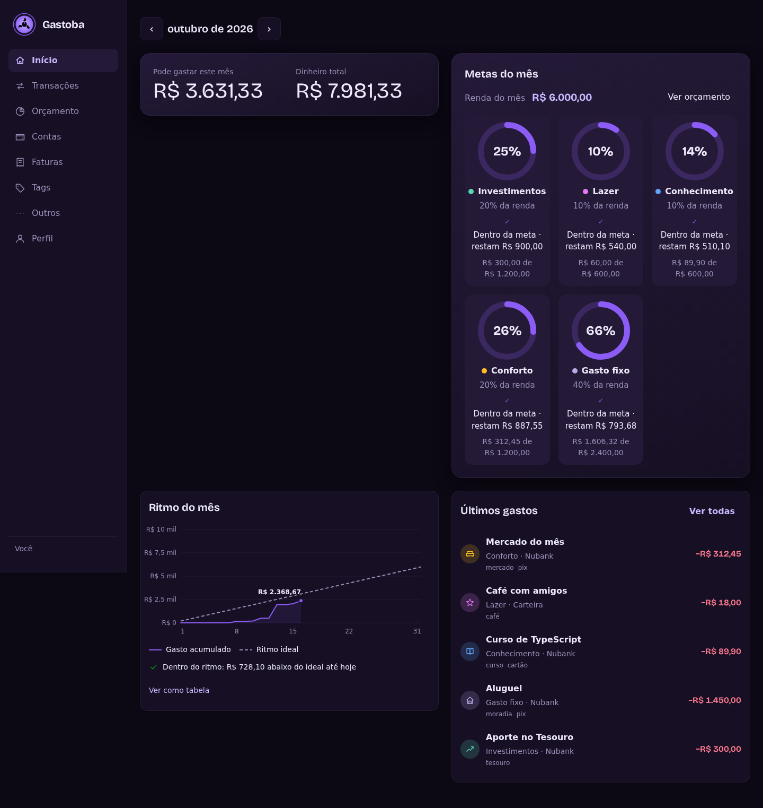

<p align="center"></p>

# Gastoba

Controle de gastos pessoais com uma interface em português: contas, gastos, ganhos, recorrências mensais, orçamento por categoria e distribuição por tags.



*A captura foi feita na simulação local. Todas as contas, transações e valores são fictícios.*

## Recursos

- Login por e-mail e senha; sessões e chaves de API com escopos de leitura ou escrita.
- Contas com saldo, gastos e ganhos; valores monetários exatos em centavos.
- Recorrências mensais, metas percentuais e gráficos por período e tags.
- Isolamento entre usuários, proteção CSRF, limite de tentativas de login e cadastro fechado por padrão.
- Importação opcional pela Pluggy, com caixa de entrada para aceitar ou ignorar transações. Requer configuração e conta compatível do provedor.
- Interface responsiva, navegação por teclado e suporte a movimento reduzido.

## Experimente a interface

Use Node.js **24.21.0** (veja `frontend/.nvmrc`).

```bash
cd frontend
npm ci
npm run dev
```

Abra `http://localhost:5173`. A simulação em memória começa na tela de login: use `voce@exemplo.com` e `senha-de-exemplo-123`. São credenciais fictícias de demonstração, sem acesso a dados reais; os dados são reiniciados ao recarregar. A simulação é eliminada do build de produção.

## Backend real

Instale o [uv](https://docs.astral.sh/uv/), que gerencia o Python **3.14** e as dependências travadas. De dentro de `backend/`:

```bash
uv sync --frozen
cp .env.example .env
uv run alembic upgrade head
uv run python -m gastoba.administracao criar-usuario --email voce@example.com --nome Voce
uv run uvicorn gastoba.api.app:criar_app --factory --reload
```

A senha é solicitada sem eco; não passe segredos pela linha de comando. A API fica em `http://localhost:8000`, com documentação em `/docs` e contrato em `/openapi.json`. O primeiro usuário é administrativo porque o cadastro vem fechado.

Para conectar o frontend, crie `frontend/.env.development.local` com `VITE_USAR_SIMULACAO=false`, reinicie o Vite e abra a interface por `localhost`. Variáveis e exemplos estão em `backend/.env.example` e `frontend/.env.example`. Nenhum segredo pode ter prefixo `VITE_`, pois esse conteúdo fica público no navegador.

## Contêiner

Na raiz, `docker compose up --build -d` inicia a API e aplica migrations; a porta é publicada somente em `127.0.0.1:8000`. O frontend pode rodar com o comando de desenvolvimento acima. `docker compose down` preserva o volume SQLite; **`docker compose down -v` apaga os dados**. A imagem usa usuário sem privilégios, filesystem somente leitura e sem capacidades extras.

## Segurança e limitações

Esta cópia pública contém código e documentação reproduzíveis, sem configuração da instalação particular. O histórico começa nesta publicação. O [relatório de revisão](SECURITY.md) registra o escopo e as limitações.

Use em localhost ou rede privada protegida. A aplicação não fornece HTTPS próprio; acesso remoto exige proxy HTTPS e cookies `Secure`. Não exponha diretamente a porta da API. O cadastro deve permanecer fechado em uma instalação pessoal. O limitador de login e tarefas periódicas foram desenhados para **uma réplica**.

A integração Pluggy é opcional e fica desligada sem credenciais configuradas no servidor. O Gastoba não recebe credenciais bancárias; a autorização acontece no provedor. Testes usam respostas simuladas e não validam conexão bancária real. Confira os termos e limites atuais do seu plano antes de ativá-la.

## Desenvolvimento e verificação

```bash
# backend/
uv run pytest
uv run ruff check .
uv run ruff format --check .

# frontend/
npm run tipos
npm test
npm run build
npm audit
```

O backend FastAPI + SQLAlchemy + SQLite segue `domain → application → infrastructure`, com composição na API. O frontend usa React + TypeScript + Vite, CSS Modules e Vitest. Dinheiro trafega como texto decimal e a aritmética usa centavos inteiros. Veja [API](Docs/API.md), [constituição](Docs/CONSTITUICAO.md) e [instruções](AGENTS.md).
