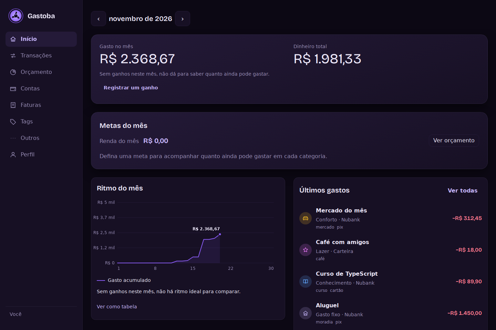

<p align="center"></p>

<h1 align="center">Gastoba</h1>

<p align="center">Controle suas finanças pessoais em português. Registre gastos e ganhos manualmente ou importe transações bancárias via <strong>Open Finance com a Pluggy</strong>.</p>

[Open Finance com a Pluggy](#open-finance-com-a-pluggy) · [Demonstração local](#experimente-a-interface) · [Instalação](#backend-real) · [Testes](#desenvolvimento-testes-e-verificação)

O Gastoba ajuda quem quer entender para onde vai o dinheiro e acompanhar contas, orçamento por categoria e metas mensais. É um projeto individual de uso pessoal, distribuído como código para executar sua própria instância em localhost ou em rede privada.



*Painel do Gastoba na demonstração local, com contas e valores fictícios.*

## Open Finance com a Pluggy

A integração opcional traz movimentações bancárias para a **Caixa de entrada** do Gastoba. Você revisa os itens importados antes de incorporá-los aos seus registros.

1. **Conecte a conta no Meu Pluggy.** A autorização bancária acontece no provedor.
2. **Sincronize as movimentações.** O backend consulta as contas configuradas e disponibiliza os itens em **Transações → Caixa de entrada**.
3. **Revise cada item.** Aceite a movimentação para registrá-la no Gastoba ou ignore-a para dispensá-la.

A importação real requer uma conta compatível no provedor. Configure `GASTOBA_PLUGGY_CLIENT_ID`, `GASTOBA_PLUGGY_CLIENT_SECRET`, `GASTOBA_PLUGGY_ITEM_IDS` e `GASTOBA_PLUGGY_EMAIL_DO_DONO` no ambiente do backend. As credenciais ficam no servidor, e a caixa de entrada fica disponível para a pessoa titular configurada. [Variáveis de configuração](backend/.env.example)

Para experimentar a revisão com dados fictícios, entre na demonstração local, abra **Transações → Caixa de entrada** e use **Sincronizar agora** se a lista estiver vazia.

## Recursos

- **Transações e contas** com gastos, ganhos, saldos, recorrências mensais e faturas.
- **Orçamento e metas** com categorias, acompanhamento mensal e gráficos por período e tags.
- **Acesso** com login por e-mail, chaves de API com escopos, isolamento entre usuários, proteção CSRF e cadastro fechado por padrão.
- **Interface responsiva** com navegação por teclado e suporte a movimento reduzido.

## Decisões técnicas

- **Dinheiro em centavos inteiros.** O value object `Dinheiro` (`backend/src/gastoba/domain/dinheiro.py`) guarda centavos inteiros (colunas `*_centavos`), e a API troca valores como texto decimal. Alternativa descartada: `float`, que acumula erros de arredondamento (Constituição, Artigo III).
- **Arquitetura em camadas com portas.** O backend segue `domain → application → infrastructure`, com a API como ponto de composição; integrações entram por portas `Protocol` em `domain/portas.py`. Um teste automatizado (`backend/tests/architecture`) verifica as dependências. Alternativa: acessar o ORM e a Pluggy direto dos casos de uso, que acoplaria as regras de negócio a bibliotecas externas (Artigo I).
- **Simulação em memória no frontend.** Com `VITE_USAR_SIMULACAO=true`, o `npm run dev` funciona sem backend, e a simulação fica fora do build de produção. Alternativa: exigir sempre a API real, o que impediria experimentar a interface sem configurar o servidor.

## Experimente a interface

Use Node.js **24.21.0** (veja `frontend/.nvmrc`).

```bash
cd frontend
npm ci
npm run dev
```

Abra `http://localhost:5173`. A simulação em memória começa na tela de login: use `voce@exemplo.com` e `senha-de-exemplo-123`. São credenciais fictícias de demonstração, sem acesso a dados reais; os dados são reiniciados ao recarregar. A simulação é eliminada do build de produção.

## Backend real

Instale o [uv](https://docs.astral.sh/uv/), que gerencia o Python **3.14** e as dependências travadas. De dentro de `backend/`:

```bash
uv sync --frozen
cp .env.example .env
uv run alembic upgrade head
uv run python -m gastoba.administracao criar-usuario --email voce@example.com --nome Voce
uv run uvicorn gastoba.api.app:criar_app --factory --reload
```

A senha é solicitada sem eco; não passe segredos pela linha de comando. A API fica em `http://localhost:8000`, com documentação em `/docs` e contrato em `/openapi.json`. O primeiro usuário é administrativo porque o cadastro vem fechado.

Para conectar o frontend, crie `frontend/.env.development.local` com `VITE_USAR_SIMULACAO=false`, reinicie o Vite e abra a interface por `localhost`. Variáveis e exemplos estão em `backend/.env.example` e `frontend/.env.example`. Nenhum segredo pode ter prefixo `VITE_`, pois esse conteúdo fica público no navegador.

## Contêiner

Na raiz, `docker compose up --build -d` inicia a API e aplica migrations; a porta é publicada somente em `127.0.0.1:8000`. O frontend pode rodar com o comando de desenvolvimento acima. `docker compose down` preserva o volume SQLite; **`docker compose down -v` apaga os dados**. A imagem usa usuário sem privilégios, filesystem somente leitura e sem capacidades extras.

## Limitações e segurança

Esta cópia pública contém código e documentação reproduzíveis, sem configuração da instalação particular. O histórico começa nesta publicação. O [relatório de revisão](SECURITY.md) registra o escopo e as limitações.

Use em localhost ou rede privada protegida. A aplicação não fornece HTTPS próprio; acesso remoto exige proxy HTTPS e cookies `Secure`. Não exponha diretamente a porta da API. O cadastro deve permanecer fechado em uma instalação pessoal. O limitador de login e tarefas periódicas foram desenhados para **uma réplica**. Os dados ficam em SQLite local, sem alta disponibilidade.

A integração com a Pluggy fica desativada por padrão. A suíte usa respostas simuladas do provedor. Confira os termos e limites do seu plano antes de ativar a importação real.

## Desenvolvimento, testes e verificação

A suíte do backend (`pytest`) reúne testes de arquitetura, unitários (domínio, aplicação e infraestrutura) e de integração das rotas, com SQLite temporário. No frontend, `npm test` roda o Vitest. Execute cada bloco a partir da pasta indicada:

```bash
# backend/
uv run pytest
uv run ruff check .
uv run ruff format --check .

# frontend/
npm run tipos
npm test
npm run build
npm audit
```

O backend FastAPI + SQLAlchemy + SQLite segue `domain → application → infrastructure`, com composição na API. O frontend usa React + TypeScript + Vite, CSS Modules e Vitest. Dinheiro trafega como texto decimal e a aritmética usa centavos inteiros. Veja [API](Docs/API.md), [constituição](Docs/CONSTITUICAO.md) e [instruções](AGENTS.md).
